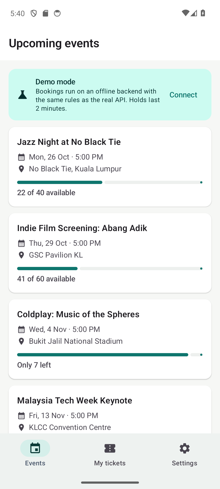
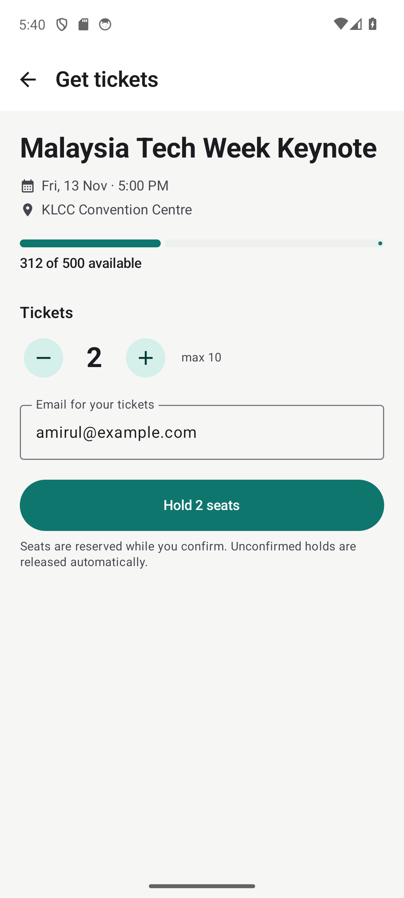
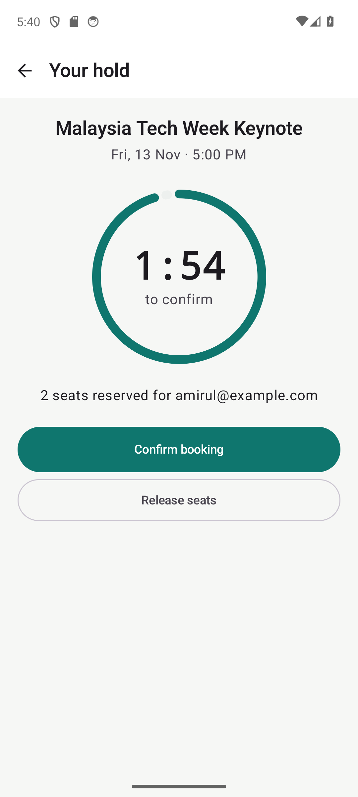
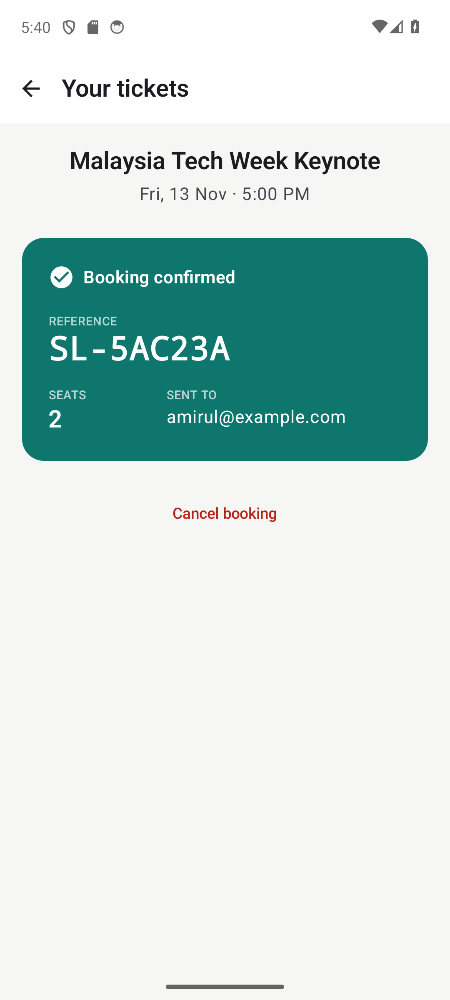

# SeatLock for Android

[](https://github.com/Tendo505/seatlock-android/actions/workflows/ci.yml)


A native Android app in **Kotlin + Jetpack Compose** for booking event tickets. It's the mobile client for **[SeatLock](https://github.com/Tendo505/seatlock)**, a Kotlin + Spring Boot API that never oversells. Browse events, hold seats with a live countdown, and confirm before the hold expires.

**📲 [Download the APK](https://github.com/Tendo505/seatlock-android/releases/latest)**. It works straight away in offline **demo mode**, with no server needed.

<p align="center">
  
  
  
  
</p>

## Features

- **Live availability:** progress bars, "Only 7 left" and "Sold out" states, and pull-to-refresh. Lists refresh automatically when you come back to them.
- **Time-limited holds:** a countdown ring while seats are reserved. When it hits zero the app waits for the server to release the seats and shows the outcome.
- **Safe retries:** every purchase attempt carries an **idempotency key**. If the network drops after the server took your seats, retrying returns the same hold instead of booking twice.
- **Clear errors:** the API's RFC 9457 problem responses become messages like "Only 1 seat left" or "Your hold expired and the seats were released".
- **Two backends:** connect to a real SeatLock server, or use the built-in **demo backend**, which enforces the same rules (no overselling, expiry, idempotency) entirely on-device.
- **My tickets:** active holds and bookings, persisted with Jetpack DataStore
- Material 3 with light and dark themes, an adaptive launcher icon, and edge-to-edge layout

## Architecture

```
ui/            Compose screens  ──observe──▶  ViewModels (StateFlow<UiState>)
                                                   │
data/          BookingRepository  ◀────────────────┘
               ├── RemoteBookingRepository   Retrofit + kotlinx.serialization → SeatLock REST API
               └── DemoBookingRepository     in-memory, Mutex-guarded, same business rules
               SettingsStore                 Jetpack DataStore (server URL, email, my holds)
AppContainer   hand-rolled DI: picks the repository from settings
```

- **MVVM with unidirectional data flow.** Each screen renders one immutable `UiState` from a `StateFlow` and sends events back to its ViewModel.
- **The repository interface hides the backend.** Swapping the real API for the demo, or for a fake in tests, needs no UI changes.
- **Idempotency lives in the ViewModel.** A key is created per purchase attempt, kept across network failures, and discarded once the server gives a definitive answer or the order changes. A test simulates a dropped connection *after* the server accepted the request and verifies the retry reuses the key.

## Bugs found by running it on a real device

Unit and UI tests passed, but running the app on an emulator against the real backend turned up three issues. All are fixed and covered by tests:

1. **Title under the status bar.** The outer scaffold consumed *all* window insets, including the top inset the inner top bar needed. Now only the bottom (navigation bar) inset is consumed.
2. **Stale data after switching servers.** The events list kept showing demo data after connecting to a real server. The list now observes the server-URL setting and reloads when it changes.
3. **Stale availability after booking.** Going back to an event still showed the old seat count. Screens now refresh on `ON_RESUME`, and a Robolectric test books seats, navigates back, and asserts the new count.

I also built the **R8-minified release APK** and booked seats through it against the live API, to make sure shrinking hadn't broken Retrofit or kotlinx.serialization.

## Running

**Install:** grab the APK from [Releases](https://github.com/Tendo505/seatlock-android/releases/latest) (Android 8.0+).

**Build from source:** open the project in Android Studio, or:

```bash
./gradlew installDebug          # with a device or emulator connected
./gradlew testDebugUnitTest     # 17 tests: unit + Robolectric UI
```

**Connect to the real API:** start [SeatLock](https://github.com/Tendo505/seatlock) (`./gradlew bootRun` or `docker compose up`), then in the app go to **Settings → API base URL** and enter `http://10.0.2.2:8080` (the emulator's address for your computer).

## Tests

**17 tests**, all running on the JVM (no emulator needed in CI):

| Suite | What it covers |
| --- | --- |
| `DemoRepositoryTest` | holds, no overselling with **200 concurrent coroutines**, expiry with a controllable clock, idempotent confirm and cancel, idempotency-key replay and reuse rejection |
| `ProblemMappingTest` | turning API problem+json bodies (including garbage) into typed errors |
| `FormatTest` | countdown and label formatting |
| `UiTest` (Robolectric + Compose) | the full flow through the real navigation graph: browse → hold → countdown → confirm; expiry; availability refresh after booking; idempotent retry after a network failure |

CI runs the tests, builds the minified release APK, and publishes it as a GitHub Release for every `v*` tag.

## Tech

Kotlin 2.3 · Jetpack Compose (Material 3) · Navigation Compose · ViewModel + StateFlow · Coroutines · Retrofit 3 · kotlinx.serialization · DataStore · R8 · JUnit 4 · Robolectric · Compose UI Test · AGP 9 · Gradle version catalog

## License

[MIT](LICENSE) © Tendo505
